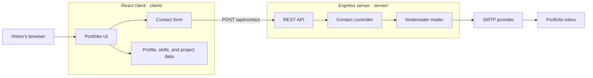
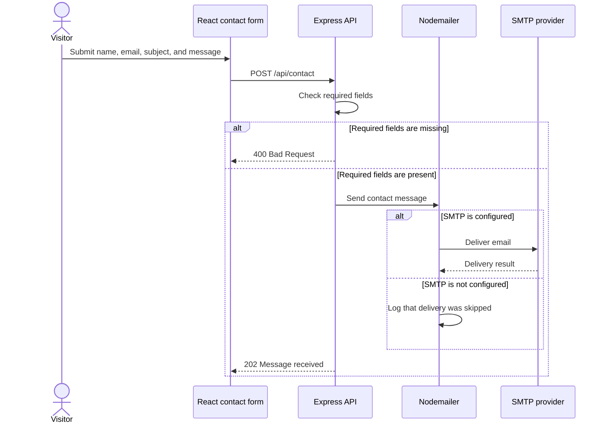

# Personal Portfolio

A responsive personal portfolio built with React and TypeScript, with an Express API for the contact form. The interface includes manga/comic themes, translated content, project filtering, and a contact form backed by SMTP email delivery.

## Features

- Portfolio sections for home, about, skills, projects, and contact
- Manga and comic theme toggle
- Translated interface using i18next
- Filterable project cards
- Express contact API with Helmet, CORS, JSON size limits, and rate limiting
- SMTP email delivery through Nodemailer

## Architecture



### Contact message flow



## Project structure

```text
.
├── client/
│   └── src/
│       ├── components/
│       │   ├── layout/       # Navbar and footer
│       │   ├── sections/     # Home, about, skills, projects, contact
│       │   └── ui/           # Reusable cards, sections, and contact form
│       ├── data/             # Profile, skills, and project content
│       └── App.tsx
└── server/
    └── src/
        ├── config/           # Environment configuration
        ├── controllers/      # Request handlers
        ├── middleware/       # Error handling
        ├── routes/           # Health and contact API routes
        ├── utils/            # Email delivery
        ├── app.js
        └── server.js
```

## Getting started

Install dependencies in both applications:

```bash
cd client
npm install

cd ../server
npm install
```

Configure the server by copying `server/.env.example` to `server/.env` and setting the SMTP values:

```dotenv
PORT=5000
CLIENT_URL=http://localhost:3000
MAIL_HOST=smtp.example.com
MAIL_PORT=587
MAIL_USER=your_email@example.com
MAIL_PASS=your_password
CONTACT_TO=your_email@example.com
```

The client defaults to `http://localhost:5000` for API requests. To use a different API origin, create `client/.env` and set:

```dotenv
REACT_APP_API_URL=http://localhost:5000
```

Start the server and client in separate terminals:

```bash
# Terminal 1
cd server
npm run dev

# Terminal 2
cd client
npm start
```

The client runs at `http://localhost:3000`; the API runs at `http://localhost:5000`. The health endpoint is `GET /api/health`.

> Without all SMTP settings (`MAIL_HOST`, `MAIL_USER`, `MAIL_PASS`, and `CONTACT_TO`), the API logs that email delivery was skipped. Configure these values to receive contact submissions.

## Tests

Run the client test suite in watchless mode:

```bash
cd client
npm test -- --watchAll=false
```

The server package currently has no configured automated tests.
